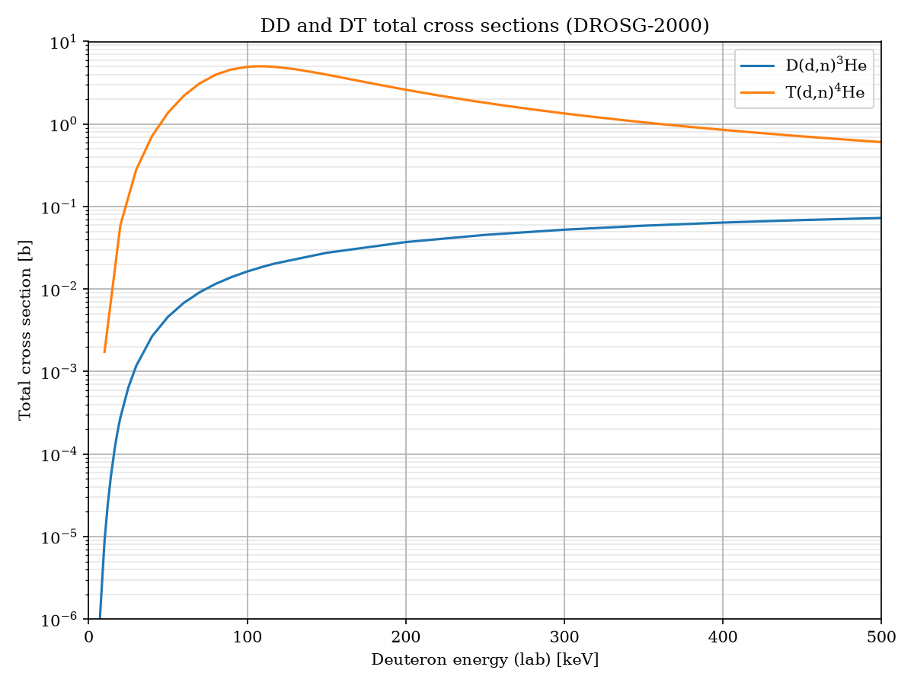
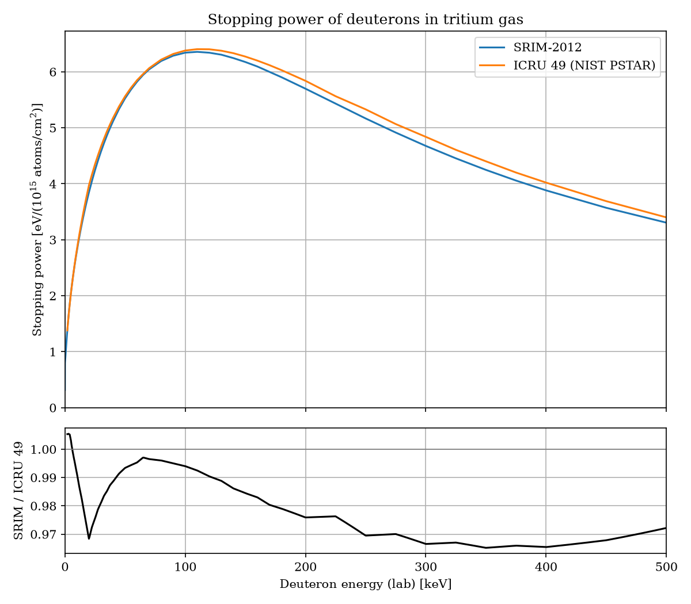

# Nuclear data

The files in this directory are read by `BeamTarget` (see `read_drosg_koe`,
`read_srim_h5`, `read_pstar`, `read_cross_sections` and `read_stopping_power` in
`source.py`, and `mass_table` and `natural_abundances` in `nuclear.py`). The DROSG files and
the mass table are kept exactly as distributed, the DROSG files including their Windows (CRLF)
line endings (see `.gitattributes`).

| File | Contents | Source |
|---|---|---|
| `d2hags.koe` | D(d,n)³He cross sections | DROSG-2000 v12.01 |
| `d3hags.koe` | T(d,n)⁴He cross sections (also used for D(t,n)⁴He) | DROSG-2000 v12.01 |
| `p3hags.koe` | T(p,n)³He cross sections (also used for H(t,n)³He) | DROSG-2000 v12.01 |
| `p7ligs.koe` | ⁷Li(p,n₀)⁷Be cross sections (⁷Be ground state) | DROSG-2000 v12.01 |
| `p7lies.koe` | ⁷Li(p,n₁)⁷Be* cross sections (⁷Be first excited state, 0.429 MeV) | DROSG-2000 v12.01 |
| `srim_stopping.h5` | Stopping powers of p, d, t, ³He, and α in every element, solid and gas | SRIM-2012.01 |
| `pstar_hydrogen.txt` | Stopping power of protons in hydrogen gas | ICRU Report 49 (NIST PSTAR) |
| `nist_isotopic_compositions.txt` | Natural isotopic compositions of the elements | NIST SRD 144 |
| `mass_1.mas20.txt` | Atomic masses of 3558 nuclides, and the element symbols | AME2020 |

## Cross sections: the `.koe` files

Unmodified data files from DROSG-2000 version 12.01 (March 2017), taken from
`DROSG2000-v12.01.zip` (`pentiumpro/2017/`). DROSG-2000 is a collection of codes and evaluated
data for accelerator-based neutron source reactions by M. Drosg, distributed by the IAEA
Nuclear Data Section at <https://www-nds.iaea.org/public/libraries/drosg2000/>. The
`d2hags.koe` file notes that up to 40 MeV it is identical to the ENDF/B-VII evaluation by Hale
and Drosg. Each file ends with the evaluator's comments on sources and changes (lines starting
with `!`).

### Format

The code reads the files the same way DROSG-2000 does (`FORMAT(10f8.0)` with `BLANK='NULL'`
in `LEGINT.f95`):

- Every line is ten 8-character fields. Spaces inside a field are ignored, blank fields are
  zero, and an exponent may be written without `e` (`8.619-4` means 8.619 × 10⁻⁴). Adjacent
  fields can therefore run together, as in `0.05115-0.04275`.
- The first line holds EMIN, EMAX, EMINL, and EMAXL [MeV]. EMAXL is the highest energy of the
  Legendre table.
- Each record is then two lines (20 fields):

  | Field | Meaning | Units |
  |---|---|---|
  | 1 | Incident projectile energy (lab frame) | MeV |
  | 2 | Center-of-mass differential cross section at 0° | mb/sr |
  | 3–20 | Legendre coefficients C₀ … C₁₇ of the angular distribution, normalized to sum to 1 | — |

The center-of-mass differential cross section at projectile energy E and cosine μ of the
center-of-mass emission angle is

    dσ/dΩ(E, μ) = σ₀(E) × Σ C_l(E) P_l(μ),   l = 0, 1, …, 17

where σ₀ is field 2. While reading, the code checks that the energies increase and that each
record's coefficients sum to 1 within 0.001 (the tolerance DROSG-2000 uses), so a damaged or
misaligned file is rejected rather than silently misread.

This code interpolates linearly between tabulated energies; the DROSG-2000 codes themselves use
spline interpolation, so values between table points can differ slightly.

**Inverse reactions.** A triton beam uses the data of the reaction with the roles swapped:
D(t,n)⁴He from `d3hags.koe` and H(t,n)³He from `p3hags.koe`. The center-of-mass cross section
is the same at the same center-of-mass energy, which a triton of energy E_t has when the
tabulated projectile has E_t × m_target / m_triton. The center-of-mass angle is measured from
the other particle, so μ changes sign.

**Valid range.** The Legendre tables cover:

| File | Legendre data [MeV] | Reaction(s) | Complete up to [MeV] | Where |
|---|---|---|---|---|
| `d2hags.koe` | 0.0018–40 | D(d,n)³He | 4.4505 | D(d,np)D opens |
| `d3hags.koe` | 0.01–40 | T(d,n)⁴He; D(t,n)⁴He | 3.7109; 5.5574 | T(d,np)T / D(t,np)T open |
| `p3hags.koe` | 1.019–32.8 | T(p,n)³He; H(t,n)³He | 8.3543; 25.0105 | T(p,np)D / H(t,np)D open |
| `p7ligs.koe` | 1.8807–23 | ⁷Li(p,n₀)⁷Be | 3.6961 | ⁷Li(p,n³He)⁴He opens |
| `p7lies.koe` | 2.372–23 | ⁷Li(p,n₁)⁷Be* | 3.6961 | ⁷Li(p,n³He)⁴He opens |

"Complete up to" is the lab beam energy at which another neutron-producing channel of the same
beam and target opens (relativistic threshold from the masses in `nuclear.py`); above it the
two-body reaction no longer gives all the neutrons. The case still runs, with a warning naming
the channel whose neutrons are missing (see `check_channels` in `source.py`, which also warns
about open (b,n), (b,2n) and (b,np) channels of any other isotope in the target, once the beam
reaches a tenth of the Coulomb barrier). (For ⁷Li, the 4.57 MeV ⁷Be state opens a little
higher, at about 7.11 MeV.) Below the first tabulated energy the code takes the cross section to
be zero, and below an endothermic reaction's threshold there are no neutrons. The records above
EMAXL are single-angle data rather than Legendre coefficients (the DROSG documentation states
there is no angular-distribution information outside the Legendre table), so the code stops
reading at EMAXL and refuses beam energies above it.

### Total cross sections

Integrating over solid angle leaves only the l = 0 Legendre term, so the total cross section
is σ(E) = 4π σ₀(E) C₀(E). Over the deuteron energies shown (up to 500 keV), the DT cross
section peaks at 5.0 b at 108 keV, while the DD cross section rises steadily; its maximum,
about 0.1 b, lies at 2–3 MeV.

The figure is made by [`docs/figures/plot_total_cross_sections.py`](../../../docs/figures/plot_total_cross_sections.py)
from the data files in this directory.

## Stopping powers

Two stopping-power sets are available, chosen with the `stopping_power` setting (in an input
file, or the `stopping_power` argument of `BeamTarget`):

| `stopping_power` | Electronic stopping | Nuclear stopping |
|---|---|---|
| `"srim"` (default) | SRIM-2012.01 (`srim_stopping.h5`) | SRIM-2012.01 |
| `"icru49"` | ICRU Report 49 (`pstar_hydrogen.txt`); hydrogen-isotope gases only | SRIM-2012.01 |

The code uses the deuteron stopping per atom of each element in a region's material, in the
material's phase (gas or solid), and combines them per atom (Bragg additivity): the stopping
per atom of the material is the sum over its atoms of each atom fraction times that element's
stopping, and the energy loss per unit length is that times the region's atom density. For
a D/T gas with a fraction f of its atoms tritium this is (1 − f) × the value in deuterium +
f × the value in tritium.
Electronic stopping, which dominates, is the same for D and T (one electron each). Nuclear
stopping per atom is about 45% higher in deuterium than in tritium, but it is below 1.5% of
the total above 10 keV and below 0.1% above 100 keV.

Per-atom mixing of D and T was checked against SRIM runs for D/T mixtures from 5% to 95%
tritium, which SRIM models as a single hydrogen target with the average mass: total stopping
agrees within 0.35% from 2 to 400 keV. The nuclear parts differ by up to 4%, because nuclear
stopping is not linear in the target mass; per-atom mixing describes a real mixture of D and T
atoms.

### SRIM for every element: `srim_stopping.h5`

Stopping powers from SRIM-2012.01 (SRIM-2006 calculation method) for five beam particles in
every single-element target, generated with SRIM's batch program (SR Module) by
[`scripts/make_srim_tables.py`](../../../scripts/make_srim_tables.py), which documents every
setting. SRIM is needed only to regenerate the file, not to use it. The code reads the
deuteron (`d`) tables with `read_srim_h5`.

- **Beam particles:** proton, deuteron, triton, helion (³He) and alpha, with CODATA 2022
  nuclear masses.
- **Targets:** elements Z = 1–92 at SRIM's natural atomic masses, plus the isotopes D, T,
  and ³He (95 targets).
- **Phases:** solid and gas, each with SRIM's own phase treatment. SRIM's gas-phase stopping
  differs from its solid-phase stopping by up to about 9% at low energies (1–5% for the
  noble gases), so a hydride target should use the solid-phase hydrogen values and a gas
  target the gas-phase ones.
- **Energies:** 253 values from 1.1 eV to 5 GeV, the same for every table: the widest range SR
  Module gives (it starts at 1.1 eV whatever lower energy is asked for, and above about 5 GeV
  it stops with an overflow error, though it accepts up to 10 GeV/u).

Stopping is stored per target atom, in eV/(10¹⁵ atoms/cm²), exactly as SRIM printed it (4
significant figures), so it does not depend on the target density. Stopping in a compound or
mixture is the sum over its atoms (Bragg additivity). SRIM's compound corrections do not cover
metal hydrides, so for those SRIM itself would also use Bragg additivity.

Layout (each dataset has a `units` attribute; stopping datasets also have `dimensions`):

| Path | Contents |
|---|---|
| `energy` | beam energy [keV], shape (253,) |
| `targets`, `target_Z`, `target_mass` | target names (`H` … `U`, then `D`, `T`, `He3`), atomic numbers and masses [u] |
| `<particle>/<phase>/electronic` | electronic stopping, shape (95 targets, 253 energies) |
| `<particle>/<phase>/nuclear` | nuclear stopping, same shape |

`<particle>` is `p`, `d`, `t`, `h` or `a` (each group has `Z`, `mass` and `description`
attributes) and `<phase>` is `solid` or `gas`. File attributes record the SRIM version,
creation date, and generating script. The script checks that the file holds exactly the values
in SRIM's output files.

Until version 0.1.0 the code used two SRIM text tables instead, for deuterons in D and in T gas
(generated 6 June 2024 with the same SRIM version, in MeV/(mg/cm²)). This file's deuteron tables
for D and T gas reproduce them within 0.06%, the rounding of SRIM's printed values in the two
unit systems; switching to it changed neutron yields by about 3 × 10⁻⁵.

### ICRU Report 49: `pstar_hydrogen.txt`

Stopping powers of protons in hydrogen gas from ICRU Report 49, as tabulated by NIST PSTAR
(<https://physics.nist.gov/PhysRefData/Star/Text/PSTAR.html>, material 001, retrieved
9 November 2026), with the values copied exactly as printed (see the file header). The code
uses the electronic stopping at the proton energy with the same velocity as the deuteron,
E_p = E_d × m_p/m_d ≈ E_d/2, converted to stopping per atom with the atomic weight ICRU 49 uses
(1.00794). The ICRU 49 nuclear stopping is for protons, so the nuclear part comes from SRIM,
mixed per atom as above. Because this file holds ICRU 49 data for hydrogen gas only,
`"icru49"` can be used only for gases made of hydrogen isotopes (H, D, T); a solid, or a gas
with any other element, is refused, so that a case run with it uses ICRU 49 throughout.
(PSTAR also tabulates about 25 other elements, but not hydrogen as a solid, so hydride
targets could not be described consistently with it.) The table starts
at a proton energy of 1 keV, so it covers deuteron energies from 2 keV; below that the beam is
treated as stopped.

### How the two compare

Electronic stopping per atom, deuterons in hydrogen gas:

| Deuteron energy | SRIM / ICRU 49 |
|---|---|
| 2–10 keV | 0.99–1.01 |
| 20–100 keV | 0.97–1.00 |
| 150–400 keV | 0.965–0.985 |

SRIM is 2–3.5% lower than ICRU 49 where the beam enters the target. For the generic cases in
`examples/generic.toml`, `"icru49"` gives neutron yields 1.4% (pure tritium) to 2.2% (pure deuterium) lower than
`"srim"`, and a beam energy at the backstop of about 9.2–9.3 keV instead of 11.7–11.8 keV. The choice of
stopping powers is therefore a systematic uncertainty of about 2% on the yields.

The figure shows the total stopping per tritium atom as the code uses it for each setting, and
their ratio; the kinks in the ratio come from the spacing of the two tables. It is made by
[`docs/figures/plot_stopping_power.py`](../../../docs/figures/plot_stopping_power.py).

## Natural isotopic compositions: `nist_isotopic_compositions.txt`

The atom fraction of each isotope in each natural element, used when a material names an
element ("Li") rather than an isotope ("7Li"). The file is the NIST *Atomic Weights and
Isotopic Compositions with Relative Atomic Masses* database (NIST Standard Reference Database
144), retrieved on 2026-11-10 from
<https://physics.nist.gov/cgi-bin/Compositions/stand_alone.pl?ele=&all=all&ascii=ascii2&isotype=all>
("Linearized ASCII Output", all isotopes). The records are kept exactly as served; only the
HTML page around them (header, navigation links, and scripts) was removed. Each record is a set
of `key = value` lines; the code reads `Atomic Number`, `Mass Number` and `Isotopic
Composition` (dropping the uncertainty in brackets), for the 288 isotopes of the 84 elements
that have a representative composition (H to Bi, Th, Pa, and U). ¹⁸⁰ᵐTa, the only natural
isomer, is listed as mass number 180; only its mass matters here. The relative atomic masses in
the file are not used (see `mass_1.mas20.txt`).

Natural compositions vary between samples, and some are often altered on purpose: commercial
lithium is frequently depleted in ⁶Li (the representative value here is 7.59%). If the
composition of a target is known, give its isotopes explicitly, for example
`atoms = { 6Li = 0.05, 7Li = 0.95 }`.

## Atomic masses: `mass_1.mas20.txt`

The atomic mass table of the 2020 Atomic Mass Evaluation (AME2020), unmodified, as distributed
by the IAEA Atomic Mass Data Center at <https://www-nds.iaea.org/amdc/> (file `mass.mas20`, the
unrounded values). The code reads each nuclide's Z, A, element symbol, and atomic mass (in
micro-u) from the fixed-width columns described in the file's header; values marked `#`
(estimated rather than measured) are read like the others. Nuclear masses are the atomic
masses less the electrons' rest mass, plus their binding energy (see `nuclear_mass`); they
agree with the CODATA 2022 masses of the neutron, proton, deuteron, triton, helion, and alpha
particle to within 0.2 eV (the neutron differs most: AME2020 predates CODATA 2022).

## Evaluated nuclear data libraries (`nuclear_data`)

Beyond the DROSG two-body reactions, the code reads evaluated data files (ENDF-6 format) for
any beam particle (p, d, t, ³He, α) on any target isotope, from libraries the user downloads:
not shipped here, because they are large (TENDL alone is tens of GB). The `nuclear_data`
setting lists the libraries to search, in order: `"drosg"` for the built-in reactions, and
directories of evaluated files. For each target isotope, the first library with data for the
beam on it is used, as MCNP searches its xsdir; an evaluation that ends below the beam energy
is skipped. A recommended order, which keeps the DROSG results for D, T, and ⁷Li and prefers
evaluations based on measurements to model calculations:

    nuclear_data = ["drosg", ".../ENDF-B-VIII.1", ".../FENDL-3.2c", ".../TENDL-2025"]

Where the libraries are belongs to the machine, not to a case, so define them once, by name,
in your configuration file, `~/.beam-target.toml` (or the file named by the
`BEAM_TARGET_CONFIG` environment variable), and name them in input files, which then
work on any machine that defines the same names:

    [libraries]
    endfb81   = "C:/data/ENDF-B-VIII.1"
    fendl32c  = "C:/data/FENDL-3.2c"
    tendl2025 = "C:/data/TENDL-2025"

    [defaults]
    nuclear_data = ["drosg", "endfb81", "fendl32c", "tendl2025"]  # When a case sets none

A relative directory in `[libraries]` is taken from the configuration file's directory. A
`nuclear_data` entry is `"drosg"`, a name from `[libraries]`, or a directory (relative to
the input file). Cases that do not set `nuclear_data` use the configuration's default, or
`["drosg"]` without one. The summary records both the entries as given (`nuclear_data`) and
the directories they resolved to (`nuclear_data_dirs`).

Each library is recognized by its file names: ENDF/B (`p-004_Be_009.endf`), FENDL
(`p_0409_4-Be-9.endf`) and TENDL (`p-Be009.tendl`, and its variants `-mt`, `-s60`, `-s20`,
and `-s0`). The evaluation used for each
reaction, from the file's header, and the file (relative to its library's directory in
`nuclear_data_dirs`) are recorded in the summary (`[reactions.<rxn>]`), the HDF5 file (the
`data` attribute of `neutrons_<rxn>`) and the SDEF header.

**What is calculated.** Every neutron-producing channel of the evaluation is merged into one
reaction (`p9Be_xn` for p + ⁹Be). At each beam energy, each channel's cross section times its
neutron yield gives the neutron production, and its energy-angle distribution, converted from
the center-of-mass frame to the lab with relativistic kinematics where needed, gives the
spectrum on the output (angle, energy) mesh, exactly conserving the total. Supported
representations (ENDF-102): LAW=1 (continuum: Kalbach-Mann, with the slope from the
systematics or given; Legendre; isotropic), LAW=2 (two-body reactions to one level, Legendre or
tabulated) and LAW=7 (lab-frame tables), with linear or unit-base interpolation between
incident energies. The beam also loses particles to nuclear reactions (the non-elastic cross
section) on its way; their power is deposited in the target.

Two choices keep thick-target spectra free of artificial stripes. Two-body channels make a
sharp line in lab energy and angle at each beam energy, so they are calculated at the beam
energy of every internal position bin, with its own kinematics. Continuum (LAW=1) spectra are
always mixed between tabulated incident energies by unit base (stretched to the outgoing-energy
range at the beam energy), even where the evaluation says linear (INT=2), as MCNP does: mixed
literally, each peak and edge of a tabulated spectrum stays at a fixed outgoing energy over the
1-2 MeV between tabulated incident energies, which leaves a stripe for each one and puts
neutrons above the highest energy the reaction can give. Neither choice changes the yields.

**TENDL variants.** TENDL publishes each evaluation in five variants of the same TALYS
calculation: the standard file gives the channels separately up to 30 MeV and lumps them into
one (MT=5) above, `-s20` and `-s60` switch at 20 and 60 MeV, `-mt` never lumps them, and
`-s0` always does. In TENDL-2025 they are not equally complete. Above about 30 MeV the
separate channels of `-mt` cover only part of the non-elastic cross section for proton,
triton, ³He, and alpha beams, so neutron production from p + ⁹Be, ⁶³Cu, and ¹⁸¹Ta at 70 MeV is
50-65% low; `-s60` has the same gap from 30 to 60 MeV. Below 30 MeV, the standard file misses
up to 22% of the non-elastic cross section for d + ⁹Be, where `-mt` is complete. The lumped
`-s0` is always complete, but its spectrum can be wrong for light targets: for 10 MeV
protons on ⁹Be it gives every neutron the (p,n) shape, putting 1% of the neutrons below 2 MeV
instead of the separate channels' 39% (from the breakup (p,np)). So where a library holds
several variants of one file, the code takes the most complete of the standard, `-mt`, and
`-s60` files up to the beam energy at entry, preferring them in that order when they are
equally complete (within 1%), and uses `-s20` or `-s0` only when none of those three is there.
For TENDL-2025 this gives the standard file for protons and alphas, and `-mt` for d + ⁹Be and
for the actinides. The file used is recorded with the reaction, as above.

Even the complete variants differ in their spectra for light targets (for d + ⁹Be at 25 MeV,
the neutrons below 2 MeV differ by more than a factor of two between the standard file and
`-mt`), so for beryllium and lithium the evaluated libraries (ENDF/B, FENDL) are preferable to
TENDL wherever they cover the beam.

A survey of all of TENDL-2025 (11,507 beam-target pairs, standard and `-mt` files, all read
without error) bears this out. For the 284 isotopes found in nature, the variant chosen leaves
out at most 1% of the non-elastic cross section up to 70 MeV for 90% of them, for every beam;
`-mt` alone leaves out a median 15-48% for p, t, ³He, and alpha beams, but is complete for
deuterons. The largest gaps that remain are on light targets: below 30 MeV, 58-73% for
p + ⁶Li and ⁷Li, 27-42% for t + ⁶Li and ⁷Li, 15-21% for ³He + ⁶Li and ⁷Li, 14% for t + ¹⁰B,
and about 10% for p, t, ³He, and alpha beams on ⁹Be. Not all of a gap emits neutrons, but some
does, and the code warns when more than 1% is missing at the beam energy.

**Validation against MCNP.** For beams stopping in thick targets, the neutrons per beam
particle agree with MCNP's neutrons created by charged-particle reactions, using the same data:
on beryllium, within 1% for protons at 10-70 MeV (ENDF/B) and deuterons at 18-70 MeV
(FENDL-3.2c, lab-frame tables), and within 1.5% for alphas at 18-70 MeV (TENDL-2021); on
aluminum and tantalum, within 2% for protons and deuterons at 18-70 MeV (ENDF/B-VII.0 and
FENDL-3.2c); on natural uranium, within 3% for protons at 18-70 MeV and 5% for deuterons at
30-70 MeV (FENDL-3.2c); and on thorium, within 2% for protons at 30 MeV (FENDL-3.2c). Only the
proton uranium files give fission a channel of its own. FENDL-3.2c's d + U files (from
TENDL-2011) give about a third as many neutrons per reaction as its proton files, so most of
the fission neutrons are probably missing, and its p + ²³²Th file lumps every reaction into
one channel, so whether it includes fission cannot be told (see Fission, below); for these,
the agreement shows only that the data are read as MCNP reads them. MCNP's tally of neutrons
escaping the target is higher, as it includes the target's own (n,2n) multiplication: a source
term must not, because the transport code models the target. The spectra agree too: for 18 MeV
protons on thick beryllium (ENDF/B-VII.0), MCNP 6.2's escaping neutrons (10¹⁰ histories, 5° cones,
0.1 MeV bins) follow the calculated spectra, fine structure and upper edges included. These
comparisons test the calculation, not the data, which MCNP shares.

**Compared with measurements.** These test the data. For 40 MeV deuterons on thick natural
lithium (Hagiwara et al., 2005), FENDL-3.2c (JENDL/DEU-2020) gives the total yield and the 0°
yield within 3%, and yields 5-37% high at 10-110°, while TENDL-2025 gives only 7% of the 0°
yield. For thick ⁷Li at 8-23 MeV (Lone et al., 1977), FENDL-3.2c is within 0-13% at 0°
above 8 MeV; for thick beryllium at 14.8-23 MeV, it gives 77-78% of Lone's 0° yields. The p + ⁹Be evaluation that ENDF/B, FENDL-3.2c, and TENDL-2021 share gives 65-73%
of the total yields measured at 62-65 MeV, and 64-81% of Lone's 0° yields at 14.8-23 MeV, but
113% of a 0° yield at 16 MeV derived from Brede et al. (1989): the measurements of p + ⁹Be
disagree among themselves too. For ⁷Li(p,n) at 1.97-2.18 MeV (Bikchurina et al., 2021), DROSG
and ENDF/B-VIII.1 agree with each other within 2%, and give 0-25% more neutrons than measured.

**Not modeled.** Neutrons made by secondary charged particles (protons, deuterons, and alphas
emitted in reactions, which can react again), a few percent at most at 70 MeV in the cases
above; and charged-particle elastic scattering, which deflects the beam slightly.

**Fission.** For thorium and heavier targets, fission often gives most of the neutrons. They are
included only if the evaluation gives fission (MT=18) neutrons explicitly, as FENDL-3.2c does for
protons on ²³⁵U and ²³⁸U (agreeing with MCNP within 3%). FENDL-3.2c's p + ²³²Th file puts every
reaction into one lumped channel (MT=5), so whether its neutrons include fission cannot be told
from the file; it is treated as having no fission. Many evaluations leave fission out: no
charged-particle file of TENDL-2025 (any beam, any variant) has a fission channel, nor do
FENDL-3.2c's deuteron files (which come from TENDL-2011) or ENDF/B-VIII.1's. The code warns when
an actinide's evaluation has no fission channel, or when it has no evaluation at all.

**Choosing data.** The libraries can differ a lot for light targets. For p + ⁹Be, ENDF/B-VIII.1,
FENDL-3.2c and TENDL-2021 hold the same evaluation (LANL, 1988; TENDL-2021 adopted it), but
TENDL-2025's model calculation gives only 44-62% of its neutrons between 10 and 70 MeV. TENDL
is the only library for most targets and for tritons, ³He, and alphas, so it is a fallback: check
its header (the `data` recorded with each reaction) to see whether a file is an adopted
evaluation or a model calculation. TENDL's files with every channel explicit can also lack
channels (the code warns when they cover less than 99% of the non-elastic cross section).
For D(d,n), T(d,n), T(p,n) and ⁷Li(p,n), DROSG and ENDF/B-VIII.1 agree for T(d,n), differ by
up to 2% in the D(d,n) cross section and by up to a factor of several in the ⁷Li(p,n)
angular distributions near threshold.

## Licensing

The MIT License in the repository's `LICENSE` file covers this project's code and
documentation, not the data files in this directory. The `.koe` files (DROSG-2000),
`srim_stopping.h5` (SRIM output) and
`pstar_hydrogen.txt` (NIST PSTAR / ICRU Report 49), `nist_isotopic_compositions.txt` (NIST)
and `mass_1.mas20.txt` (AME2020) are redistributed unmodified, or with values copied exactly, from the sources above, which are freely available, and remain subject to their
sources' terms. Please cite those sources when using the data.

## References

- M. Drosg, DROSG-2000, Codes and database for 60 neutron source reactions, documented in the
  IAEA report IAEA-NDS-87 Rev. 10 (January 2016), downloaded from the homepage of IAEA Nuclear
  Data Section. (Citation as recommended by the DROSG-2000 documentation; the version used here,
  12.01, is documented in IAEA-NDS-87 Rev. 10, March 2017:
  <https://www-nds.iaea.org/public/libraries/drosg2000/iaeands-v12.01.pdf>.)
- J. F. Ziegler, M. D. Ziegler, and J. P. Biersack, "SRIM – The stopping and range of ions in
  matter (2010)", Nucl. Instrum. Methods Phys. Res. B 268 (2010) 1818–1823.
- J. S. Coursey, D. J. Schwab, J. J. Tsai, and R. A. Dragoset, *Atomic Weights and Isotopic
  Compositions with Relative Atomic Masses*, NIST Standard Reference Database 144,
  <https://www.nist.gov/pml/atomic-weights-and-isotopic-compositions-relative-atomic-masses>.
- W. J. Huang, M. Wang, F. G. Kondev, G. Audi, and S. Naimi, "The AME 2020 atomic mass
  evaluation (I)", Chin. Phys. C 45 (2021) 030002.
- M. Wang, W. J. Huang, F. G. Kondev, G. Audi, and S. Naimi, "The AME 2020 atomic mass
  evaluation (II)", Chin. Phys. C 45 (2021) 030003.
- ICRU Report 49, *Stopping Powers and Ranges for Protons and Alpha Particles*, International
  Commission on Radiation Units and Measurements (1993).
- M. J. Berger, J. S. Coursey, M. A. Zucker, and J. Chang, *ESTAR, PSTAR, and ASTAR: Computer
  Programs for Calculating Stopping-Power and Range Tables for Electrons, Protons, and Helium
  Ions*, NIST Standard Reference Database 124.

Measurements compared with above:

- M. Hagiwara et al., "Measurement of neutron emission spectra in Li(d,xn) reaction with thick
  and thin targets for 40-MeV deuterons", Fusion Sci. Technol. 48 (2005) 1320–1328 (EXFOR
  E1986).
- M. A. Lone et al., "Thick target neutron yields and spectral distributions from the
  ⁷Li(d,n) and ⁹Be(d,n) reactions", Nucl. Instrum. Methods 143 (1977) 331–344 (EXFOR C1837).
- R. Alba et al., "Measurement of neutron yield by 62 MeV proton beam on a thick beryllium
  target", arXiv:1208.1713 (2012).
- I. Tilquin et al., Nucl. Instrum. Methods Phys. Res. A 545 (2005) 339.
- H. J. Brede et al., "Neutron yields from thick Be targets bombarded with deuterons or
  protons", Nucl. Instrum. Methods Phys. Res. A 274 (1989) 332–344, as used by A. Fenyvesi,
  arXiv:1504.07399.
- T. Bikchurina et al., "The measurement of the neutron yield of the ⁷Li(p,n)⁷Be reaction in
  lithium targets", Biology 10 (2021) 824.
