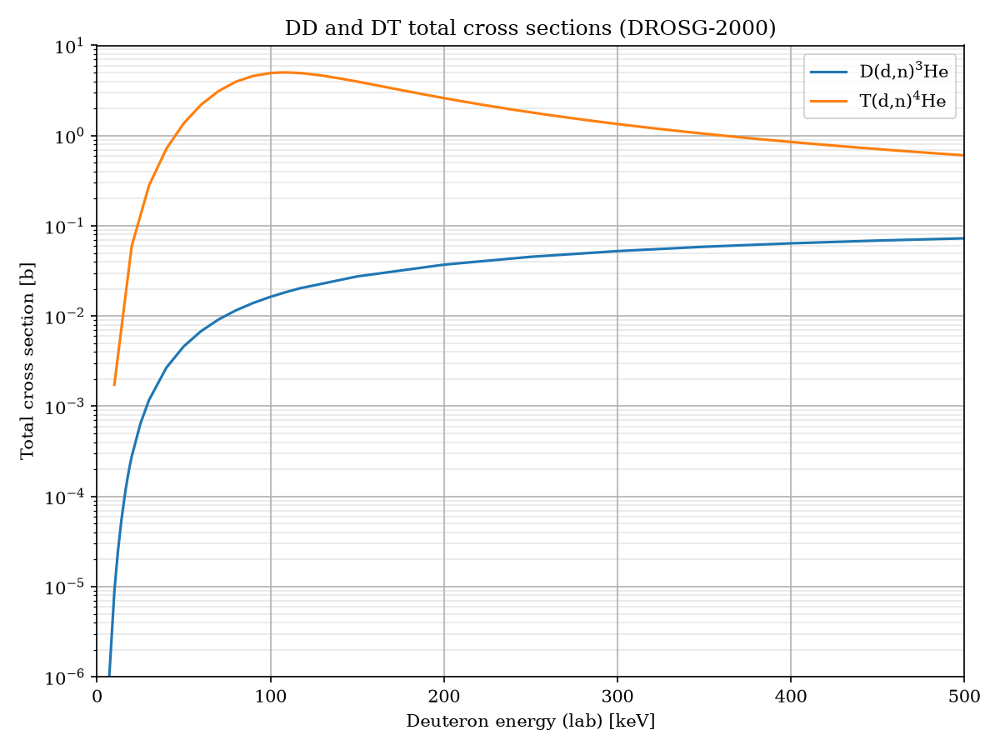
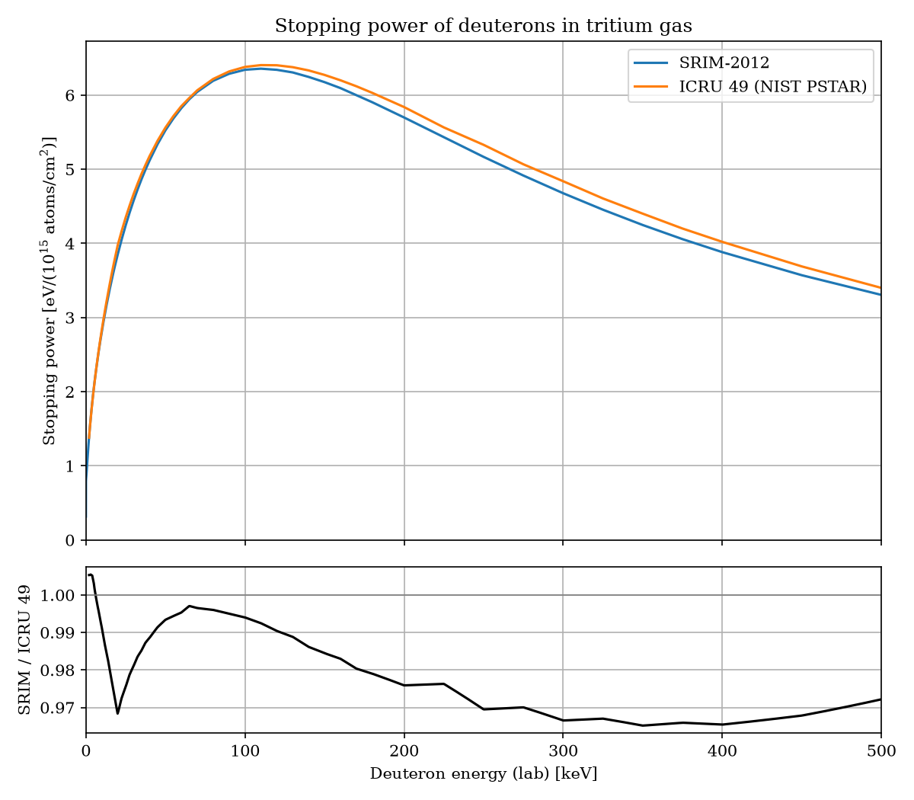

# Nuclear data

The files in this directory are read by `ShineSource` (see `read_drosg_koe`,
`read_srim_stopping`, `read_pstar`, `read_cross_sections` and `read_stopping_power` in
`source.py`). The DROSG and SRIM files are kept exactly as distributed, including their Windows
(CRLF) line endings (see `.gitattributes`).

| File | Contents | Source |
|---|---|---|
| `d2hags.koe` | D(d,n)³He cross sections | DROSG-2000 v12.01 |
| `d3hags.koe` | T(d,n)⁴He cross sections | DROSG-2000 v12.01 |
| `srim_deuteron_in_D_gas.txt` | Stopping power of deuterons in deuterium gas | SRIM-2012.01 |
| `srim_deuteron_in_T_gas.txt` | Stopping power of deuterons in tritium gas | SRIM-2012.01 |
| `pstar_hydrogen.txt` | Stopping power of protons in hydrogen gas | ICRU Report 49 (NIST PSTAR) |
| `srim_stopping.h5` | Stopping powers of p, d, t, ³He and α in every element, solid and gas | SRIM-2012.01 |

## Cross sections: `d2hags.koe`, `d3hags.koe`

Unmodified data files from DROSG-2000 version 12.01 (March 2017), taken from
`DROSG2000-v12.01.zip` (`pentiumpro/2017/`). DROSG-2000 is a collection of codes and evaluated
data for accelerator-based neutron source reactions by M. Drosg, distributed by the IAEA
Nuclear Data Section at <https://www-nds.iaea.org/public/libraries/drosg2000/>. The
`d2hags.koe` file notes that up to 40 MeV it is identical to the ENDF/B-VII evaluation by Hale
and Drosg. Each file ends with the evaluator's comments on sources and changes (lines starting
with `!`).

### Format

The code reads the files the same way DROSG-2000 does (`FORMAT(10f8.0)` with `BLANK='NULL'`
in `LEGINT.f95`):

- Every line is ten 8-character fields. Spaces inside a field are ignored, blank fields are
  zero, and an exponent may be written without `e` (`8.619-4` means 8.619 × 10⁻⁴). Adjacent
  fields can therefore run together, as in `0.05115-0.04275`.
- The first line holds EMIN, EMAX, EMINL and EMAXL [MeV]. EMAXL (40 MeV in both files) is the
  highest energy of the Legendre table.
- Each record is then two lines (20 fields):

  | Field | Meaning | Units |
  |---|---|---|
  | 1 | Incident deuteron energy (lab frame) | MeV |
  | 2 | Centre-of-mass differential cross section at 0° | mb/sr |
  | 3–20 | Legendre coefficients C₀ … C₁₇ of the angular distribution, normalised to sum to 1 | — |

The centre-of-mass differential cross section at deuteron energy E and cosine μ of the
centre-of-mass emission angle is

    dσ/dΩ(E, μ) = σ₀(E) × Σ C_l(E) P_l(μ),   l = 0, 1, …, 17

where σ₀ is field 2. While reading, the code checks that the energies increase and that each
record's coefficients sum to 1 within 0.001 (the tolerance DROSG-2000 uses), so a damaged or
misaligned file is rejected rather than silently misread.

This code interpolates linearly between tabulated energies; the DROSG-2000 codes themselves use
spline interpolation, so values between table points can differ slightly.

**Valid range.** The Legendre data cover 1.8 keV to 40 MeV for DD and 10 keV to 40 MeV for DT.
Below the first energy the code takes the cross section to be zero. The records above EMAXL
(40.0001 MeV upwards) are single-angle data rather than Legendre coefficients (the DROSG
documentation states there is no angular-distribution information outside the Legendre
table), so the code stops reading at EMAXL and limits the beam voltage to 40,000 kV
(`MAX_VOLTAGE`).

### Total cross sections

Integrating over solid angle leaves only the l = 0 Legendre term, so the total cross section
is σ(E) = 4π σ₀(E) C₀(E). Over the deuteron energies shown (up to 500 keV), the DT cross
section peaks at 5.0 b at 108 keV, while the DD cross section rises steadily; its maximum,
about 0.1 b, lies at 2–3 MeV.

The figure is made by [`docs/figures/plot_total_cross_sections.py`](../../../docs/figures/plot_total_cross_sections.py)
from the data files in this directory.

## Stopping powers

Two stopping-power sets are available, chosen with the `stopping_power` setting (in an input
file, or the `stopping_power` argument of `ShineSource`):

| `stopping_power` | Electronic stopping | Nuclear stopping |
|---|---|---|
| `"srim"` (default) | SRIM-2012.01 | SRIM-2012.01 |
| `"icru49"` | ICRU Report 49 (`pstar_hydrogen.txt`) | SRIM-2012.01 |

Both are used as stopping per gas atom, multiplied by the atom density. For a D/T mixture the
stopping per atom is combined per atom (Bragg additivity): (1 − T_frac) × the value in
deuterium + T_frac × the value in tritium. Electronic stopping, which dominates, is the same
for D and T (one electron each). Nuclear stopping per atom is about 45 % higher in deuterium
than in tritium, but it is below 1.5 % of the total above 10 keV and below 0.1 % above
100 keV: compared with using the tritium table for all mixtures, it lowers the DD yield of the
generic pure-deuterium case (`DD`) by 0.03 %.

### SRIM: `srim_deuteron_in_D_gas.txt`, `srim_deuteron_in_T_gas.txt`

Unmodified output of SRIM (<http://www.srim.org/>), version SRIM-2012.01 with the SRIM-2006
calculation method, generated 6 June 2024 (SRIM's own file names `SRIM_d_Gas_D.txt` and
`SRIM_d_Gas_T.txt`): stopping power of deuterons (mass 2.013553 amu) in pure deuterium and pure
tritium gas targets (Bragg correction 0%), from 1.1 eV to 100 MeV. The code uses the electronic
and nuclear stopping columns, in MeV/(mg/cm²), and converts them to stopping per atom with the
exact mass of each target isotope, identified from the header's density and atom density. It
checks that each file has the expected target isotope, that both use the same energy grid and
that their electronic stopping per atom agrees within 1 % (it agrees within 0.06 %).

Per-atom mixing was checked against SRIM runs for D/T mixtures from 5 % to 95 % tritium, which
SRIM models as a single hydrogen target with the average mass: total stopping agrees within
0.35 % from 2 to 400 keV. The nuclear parts differ by up to 4 %, because nuclear stopping is
not linear in the target mass; per-atom mixing describes a real mixture of D and T atoms.

### SRIM for every element: `srim_stopping.h5`

Stopping powers from SRIM-2012.01 (SRIM-2006 calculation method) for five beam particles in
every single-element target, generated with SRIM's batch program (SR Module) by
[`scripts/make_srim_tables.py`](../../../scripts/make_srim_tables.py), which documents every
setting. SRIM is needed only to regenerate the file, not to use it. The file is not yet used by
the code; it is the basis for targets other than D/T gas.

- **Beam particles:** proton, deuteron, triton, helion (³He) and alpha, with CODATA 2022
  nuclear masses.
- **Targets:** elements Z = 1–92 at SRIM's natural atomic masses, plus the isotopes D, T and
  ³He (95 targets).
- **Phases:** solid and gas, each with SRIM's own phase treatment. SRIM's gas-phase stopping
  differs from its solid-phase stopping by up to about 9 % at low energies (1–5 % for the
  noble gases), so a hydride target should use the solid-phase hydrogen values and a gas
  target the gas-phase ones.
- **Energies:** 208 values from 1.1 eV to 100 MeV, the same for every table and the same grid
  as the two text files above.

Stopping is stored per target atom, in eV/(10¹⁵ atoms/cm²), exactly as SRIM printed it (4
significant figures), so it does not depend on the target density. Stopping in a compound or
mixture is the sum over its atoms (Bragg additivity). SRIM's compound corrections do not cover
metal hydrides, so for those SRIM itself would also use Bragg additivity.

Layout (each dataset has a `units` attribute; stopping datasets also have `dimensions`):

| Path | Contents |
|---|---|
| `energy` | beam energy [keV], shape (208,) |
| `targets`, `target_Z`, `target_mass` | target names (`H` … `U`, then `D`, `T`, `He3`), atomic numbers and masses [u] |
| `<particle>/<phase>/electronic` | electronic stopping, shape (95 targets, 208 energies) |
| `<particle>/<phase>/nuclear` | nuclear stopping, same shape |

`<particle>` is `p`, `d`, `t`, `h` or `a` (each group has `Z`, `mass` and `description`
attributes) and `<phase>` is `solid` or `gas`. File attributes record the SRIM version,
creation date and generating script. The script checks that the file holds exactly the values
in SRIM's output files. The deuteron tables for D and T gas agree with
`srim_deuteron_in_D_gas.txt` and `srim_deuteron_in_T_gas.txt` within 0.06 %, the rounding of
SRIM's printed values in the two unit systems.

### ICRU Report 49: `pstar_hydrogen.txt`

Stopping powers of protons in hydrogen gas from ICRU Report 49, as tabulated by NIST PSTAR
(<https://physics.nist.gov/PhysRefData/Star/Text/PSTAR.html>, material 001, retrieved
9 November 2026), with the values copied exactly as printed (see the file header). The code
uses the electronic stopping at the proton energy with the same velocity as the deuteron,
E_p = E_d × m_p/m_d ≈ E_d/2, converted to stopping per atom with the atomic weight ICRU 49 uses
(1.00794). The ICRU 49 nuclear stopping is for protons, so the nuclear part comes from SRIM,
mixed per atom as above. The
table starts at a proton energy of 1 keV, so it covers deuteron energies from 2 keV; below that
the beam is treated as stopped.

### How the two compare

Electronic stopping per atom, deuterons in hydrogen gas:

| Deuteron energy | SRIM / ICRU 49 |
|---|---|
| 2–10 keV | 0.99–1.01 |
| 20–100 keV | 0.97–1.00 |
| 150–400 keV | 0.965–0.985 |

SRIM is 2–3.5 % lower than ICRU 49 where the beam enters the target. For the generic cases in
`examples/generic.toml`, `"icru49"` gives neutron yields 1.4 % (pure tritium) to 2.2 % (pure deuterium) lower than
`"srim"`, and a beam energy at the backstop of about 9.2–9.3 keV instead of 11.7–11.8 keV. The choice of
stopping powers is therefore a systematic uncertainty of about 2 % on the yields.

The figure shows the total stopping per tritium atom as the code uses it for each setting, and
their ratio; the kinks in the ratio come from the spacing of the two tables. It is made by
[`docs/figures/plot_stopping_power.py`](../../../docs/figures/plot_stopping_power.py).

## Licensing

The MIT License in the repository's `LICENSE` file covers this project's code and
documentation, not the data files in this directory. `d2hags.koe` and `d3hags.koe` (DROSG-2000),
`srim_deuteron_in_D_gas.txt`, `srim_deuteron_in_T_gas.txt` and `srim_stopping.h5` (SRIM output) and
`pstar_hydrogen.txt` (NIST PSTAR / ICRU Report 49) are redistributed unmodified, or with values
copied exactly, from the sources above, which are freely available, and remain subject to their
sources' terms. Please cite those sources when using the data.

## References

- M. Drosg, DROSG-2000, Codes and database for 60 neutron source reactions, documented in the
  IAEA report IAEA-NDS-87 Rev. 10 (January 2016), downloaded from the homepage of IAEA Nuclear
  Data Section. (Citation as recommended by the DROSG-2000 documentation; the version used here,
  12.01, is documented in IAEA-NDS-87 Rev. 10, March 2017:
  <https://www-nds.iaea.org/public/libraries/drosg2000/iaeands-v12.01.pdf>.)
- J. F. Ziegler, M. D. Ziegler and J. P. Biersack, "SRIM – The stopping and range of ions in
  matter (2010)", Nucl. Instrum. Methods Phys. Res. B 268 (2010) 1818–1823.
- ICRU Report 49, *Stopping Powers and Ranges for Protons and Alpha Particles*, International
  Commission on Radiation Units and Measurements (1993).
- M. J. Berger, J. S. Coursey, M. A. Zucker and J. Chang, *ESTAR, PSTAR, and ASTAR: Computer
  Programs for Calculating Stopping-Power and Range Tables for Electrons, Protons, and Helium
  Ions*, NIST Standard Reference Database 124.
